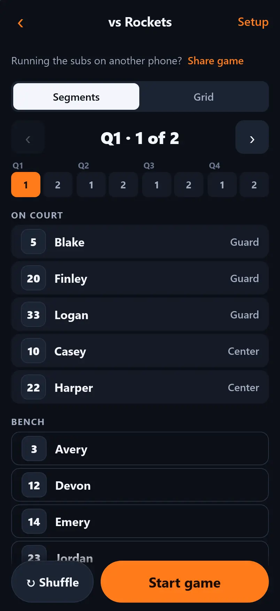
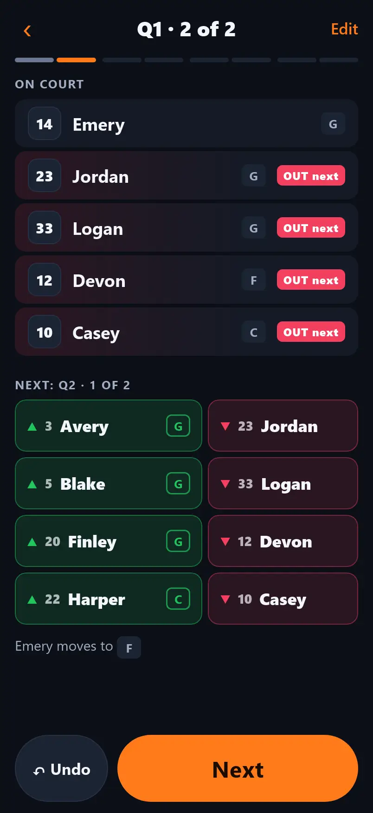
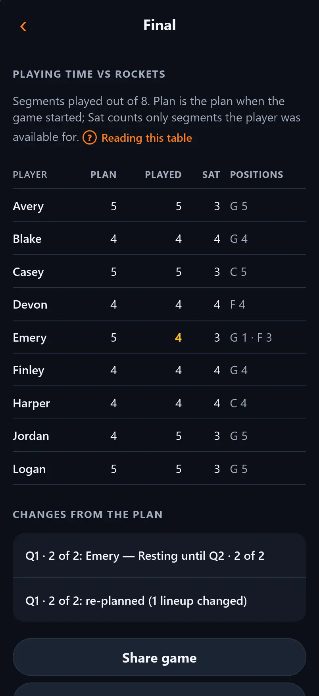
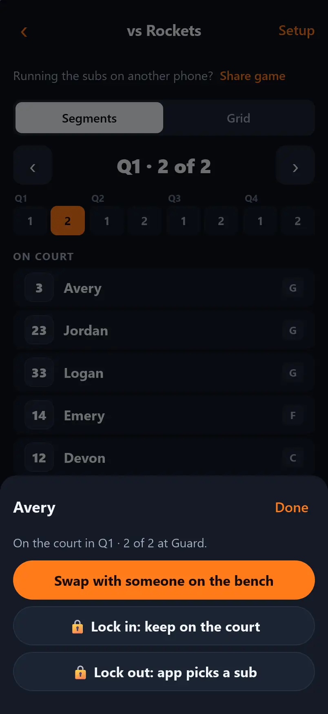
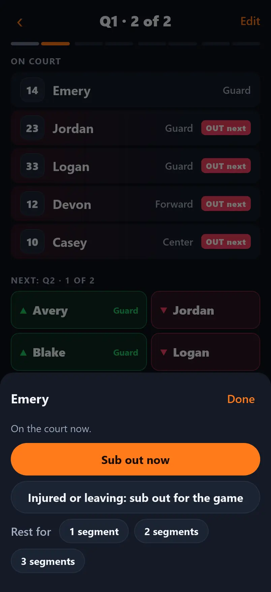

# next5

**Fair basketball rotations, planned before the game and run with one tap during it.**

next5 is an iPhone app for youth basketball coaches. You enter your roster once. Before each game you mark who showed up, and next5 builds a rotation that gives everyone fair playing time and always has the positions you need on the court. During the game, the screen shows who is on the court, who comes **in**, who goes **out**, and what position each incoming player plays. Tap **Next** at each substitution.

- Works with no internet once installed. Everything is stored on your phone.
- Free: no App Store, no account, no subscription.

App: **https://mattbat.com/next5/**

<p>
  
  
  
</p>

---

## For coaches

### Install it on your iPhone

1. Open **https://mattbat.com/next5/** in **Safari**. Other browsers on iPhone can't install apps.
2. Tap the **Share** button (the square with an arrow pointing up).
3. Scroll down and tap **Add to Home Screen**, then **Add**.
4. Open next5 from the new icon on your Home Screen.

It opens full screen like any other app and works in gyms with no signal.

### Help in the app

The first time next5 opens, a short intro shows what it does (tap **Skip** to go straight in). After that, tap **Help** at the top left of the Teams screen, or **Settings → Help and guide**, for a full guide with pictures: setting up a team, planning, changing the plan, game day, injuries and re-planning, stats, sharing with an assistant, backups, and common questions. Screens with something to explain have a **?** link to the right page. **‹** goes back a page, and **Done** returns you to the screen you were on. **Help → Replay the intro** shows the intro again.

### Quick start

1. **Add your team.** Type a name (e.g. *8U Thunder*) and tap **Add**. To look around first, tap **Load demo team** instead; it adds a team of made-up players.
2. **Build your roster.** Tap **+ Add** for each player. Enter a name, a jersey number, and for each position they can play, a skill level:
   - **Rising**: still learning this position
   - **Steady**: comfortable and reliable here
   - **Go-To**: who you want here in a close game

   Skill levels appear only on this screen, never on game day.
3. **Set up the team once** on the **Settings** tab:
   - **Position requirement**: the minimum number of players who can play each position in every lineup. For example, *Guard 2* means at least two players who can play Guard are always on the court.
   - **Default game format**: quarters or halves, and how many lineups per period. The default is 2 per quarter, a sub at the middle and at the end of each quarter.
   - **Default rules**: see *How the rotation is built* below.
4. **Plan a game.** Teams open on the **Games** tab. Tap **+ New game**. Uncheck anyone who isn't coming, then tap **Generate plan**.
5. **Check the plan.** The plan opens on the first segment: who's on the court, at what position, and who sits. Step through with **‹ ›**, or tap a segment under Q1–Q4 to jump to it. Tap a player to:
   - **Swap** them with someone on the bench (or put a bench player in for someone),
   - **Lock in** to keep them on the court in that segment, or **Lock out** to keep them on the bench.

   

   Every change is kept as a 🔒 lock, and the rest of the plan adjusts straight away to keep playing time fair, changing as little as possible. **↶ Undo** reverses the last change. **🔒 Lock lineup** keeps a whole five, such as your closing lineup. **↻ Redo from here** makes new lineups from that segment on, keeping earlier segments and every lock. **Grid** shows the whole game: players (rows) by lineups (columns), a letter for the position, a ring for a lock-in, ✕ for a lock-out, and each player's total. **↻ Shuffle** makes a whole new plan that is just as fair, still keeping your locks.
6. **Start the game.** Tap **Start game**. At each substitution, read the green **▲ IN** and red **▼ OUT** pairs, send the players in, and tap **Next**. Tapped Next, or made a sub, by mistake? Tap **↶ Undo**: it takes back the last thing you did, whether a sub, a status change, a re-plan, overtime or Next.
   

7. After the last lineup tap **End game** to see everyone's playing time: segments planned, played and sat, and the positions they played. **Export stats (CSV)** sends the table to Files, Mail or Numbers. The game is saved in the team's history.
8. **Season stats.** The team's **Stats** tab adds up every finished game: games, segments played, the share of available segments they played, and segments at each position. **Export season stats (CSV)** opens in Excel, Numbers or Google Sheets. Skill levels are never exported.

The screen stays awake during a game. If the phone locks anyway, or you switch apps, next5 picks up exactly where you left off.

### When the game doesn't go to plan

- **Sub someone out right now:** tap the player in the **On court** list, then **Sub out now**, and pick who goes in. Both players get credit for that segment.
- **Send in someone else at the next sub:** tap a green **▲ IN** player and pick a replacement. Only the next lineup changes, and a later re-plan keeps your pick.
- **Injury, or a player leaves:** tap the player, then **Injured or leaving**. If they're on the court, pick who replaces them now. They're out for the rest of the game.
- **Give someone a rest:** tap the player, then **Rest for 1, 2 or 3 segments**.
- **Late arrival:** tap **Edit** (top right) → **Show players not here** → tap the player → **Arrived**. They can play from the next segment.
- **Re-plan:** after any of these, next5 offers to re-plan the rest of the game. A preview shows exactly which lineups change (new players in green) before you tap **Use new plan**. Segments already played never change, and it moves as few players as possible. If you keep the old plan, a yellow banner reminds you while someone who can't play is still in an upcoming lineup.
- **Overtime:** on the last segment, tap **+ OT** (or **Edit → Add overtime segment**) to add another lineup, planned with the same rules.
- **See the rest of the plan:** **Edit → See full plan** shows every lineup (or the grid), starting at the one on the court now. It's read-only; back takes you to the game.
- **Time runs out early:** **Edit → End game now**, then confirm. The lineup on the court counts as played and the rest of the plan doesn't. **↶ Undo end of game** on the Final screen picks up where you were.
- **A paper copy:** on the plan's **Grid** view, **Share plan as text** sends every lineup to Messages or Notes, or to Print from the share sheet.

Every change is listed under **Changes from the plan** in the game summary.

When you pick a replacement, players who can play that spot's position are listed first, then everyone else, and each player shows the positions they play (G, F, C). If your pick breaks one of your rules (no one covering Center, uneven playing time, someone sitting too long), next5 tells you and you can tap **Swap anyway**. During a game you're always in charge; plans next5 generates still always cover your positions.

### How the rotation is built

Each rule can be turned on or off for the team, and changed for a single game:

| Rule | What it does |
|------|--------------|
| **Cover positions** | Every lineup meets the position requirement. This rule is never broken. If the players who showed up can't cover a position, next5 tells you what's missing. |
| **Equal playing time** | Everyone plays the same number of lineups, give or take one. |
| **Don't sit too long** | Players go back in as soon as the roster allows. With 10 or fewer players nobody sits twice in a row; with 11–15, nobody sits more than two in a row. |
| **Balance skill** | Avoids putting several Rising players on the court together, and spreads Go-To players across the game. |

When rules conflict, they win in this order: positions, equal time, don't sit too long, balance skill. If a rule has to give, the plan shows a **Heads up** note explaining exactly who is affected.

Playing time is counted in lineups, not minutes. The goal is best-effort fairness, not a stopwatch.

### Your data

Everything is saved on your phone as you go. There is no Save button. Your data is **lost if you delete the app from the Home Screen** or clear Safari's website data, so back it up now and then:

- **Archive a past season's team:** open the team → **Settings** tab → **Archive team**. It leaves your Teams list but keeps its players, games and stats. Tap **Show archived teams** on the Teams screen to open it again, and **Unarchive** to bring it back.
- **Light or dark:** next5 is dark by default, which is easiest to read in most gyms. On the Teams screen tap **Settings** (top right) → **Appearance** to pick **Light**, or **Match phone** to follow your iPhone's setting.
- **Back up:** on the Teams screen tap **Settings** (top right) → **Back up all teams**. The share sheet opens: choose **Save to Files** (iCloud Drive is a good place) or AirDrop it to another device. To back up just one team, open the team → **Settings** tab → **Back up this team**.
- **Restore:** **Settings** → **Restore from a backup file** and pick the file. next5 shows what's in it, then:
  - **Merge into this phone** adds anything missing; where both have a copy, the more recently changed one is kept. Nothing is deleted.
  - **Replace everything** makes the phone exactly match the backup (you're asked to confirm first).
- **Reminder:** if you've never backed up, or it's been over a month, the Teams screen reminds you. **Later** hides it for a week.

Settings also has **Check for updates** and the app version.

### Sharing a game with your assistant

If an assistant runs the subs on their phone, either of you can share the game with the other at any point: before, during or after the game. Tap **Share game** on the plan screen, in the Game Day **Edit** menu, or on the Final screen, then choose **Text a link** (Messages, WhatsApp, email) or **AirDrop a file** (when you're together; works with no signal).

To open a shared game, tap the link and then **Open here**. If you use the next5 app on your Home Screen, tap **Copy for the next5 app** instead, then open next5 and tap **Paste game** on the Teams screen. For an AirDropped file, tap **Open game file** on the Teams screen.

Some ways to use it:

- **Before the game:** the coach shares the plan. Changed something? Share again; it replaces the assistant's copy until they start the game.
- **Assistant has to leave:** they share the game in progress. The coach opens it and carries on from the same segment, with every swap so far.
- **Assistant missed a game:** the coach shares the finished game, so the assistant's season stats are complete.

Only one phone runs a game at a time. After you share a game that's in progress, your phone shows **The other phone is running this game** and won't let you tap Next or make swaps. If the other phone can't carry on (a dead battery, say), tap **Take back control**. A phone that has already played further won't let an older copy wipe out its swaps.

### Updates

When a new version is ready, a banner says **A new version of next5 is ready**. Tap **Update** when convenient; your teams and games are kept. The banner never appears on the screens of a game in progress. After updating, a short note says what's new; **Settings → What's new** lists every version.

---

## For developers

### Stack

- **React 19 + TypeScript** built with **Vite**
- **vite-plugin-pwa** (Workbox) for the service worker, offline caching and update prompts
- **Dexie** (IndexedDB) for on-device storage
- **Vitest** + **fast-check** + **Testing Library** for unit, property and component tests
- **Playwright** for end-to-end tests in WebKit at iPhone 17 size
- **GitHub Actions** for CI, deploying to **GitHub Pages**

### Getting started

You need Node 24 or later.

```bash
npm install
npm run dev          # http://localhost:5173/next5/
```

| Command | What it does |
|---------|--------------|
| `npm run dev` | Dev server with hot reload |
| `npm run build` | Type-check and build to `dist/` |
| `npm run preview` | Serve the production build at http://localhost:4173/next5/ |
| `npm run lint` | ESLint |
| `npm run typecheck` | TypeScript, no output |
| `npm test` | Unit, property and component tests with coverage |
| `npm run test:e2e` | Playwright end-to-end tests (run `npm run build` first) |
| `npm run check` | Everything above, in CI order |
| `npm run icons` | Regenerate PNG icons from `public/favicon.svg` |
| `npm run screenshots` | Retake the help screenshots in `public/help/` (builds first) |

The first time you run e2e tests, install the browsers with `npx playwright install webkit chromium`.

To try a dev build on a phone on the same Wi-Fi, run `npm run dev -- --host` and open the printed network address. Service workers need HTTPS, so offline mode and installing only work on the deployed site.

### Project layout

```
src/
  engine/       Rotation engine: pure TypeScript, no UI or storage
    generate.ts     builds plans
    analyze.ts      scores plans and produces warnings
    positions.ts    position coverage (bipartite matching) and assignment
    substitutions.ts  works out IN/OUT pairs between two lineups
  domain/       Game logic shared by screens: labels, Next/Undo, ending early (game.ts),
                plan editing: locks, swaps, redo (planning.ts), game-day changes: swaps,
                statuses, re-plan, overtime (changes.ts), stats and CSV (stats.ts),
                the plan as text (planText.ts)
  data/         Storage: Dexie schema (db.ts), the only module that writes (repo.ts),
                backup files and restore (backup.ts), share sheet / download (share.ts),
                handing a game to the assistant by link or file (handoff.ts), checks on
                files and links from outside (validate.ts), What's new (whatsNew.ts)
  screens/      One component per screen
  components/   Shared UI (top bar, toggles, sheets, G/F/C position chips, update banner,
                What's new, install hint, first-run intro)
  help/         The in-app guide: topics (topics.tsx), screenshot list (shots.ts), intro state
  hooks/        useGameData, useWakeLock, useInLiveGame
  changelog.json  Release notes the app shows (written by npm run release)
e2e/            Playwright tests
scripts/screens/  Takes the help screenshots (npm run screenshots)
scripts/release.mjs  Releases and the changelog check (npm run release)
changes/        Changelog notes waiting for the next release
CHANGELOG.md    What changed in each release
public/help/    Help screenshots, <name>-dark.webp and <name>-light.webp
docs/STATUS.md  Which requirements are done
REQUIREMENTS.md The spec
```

Routing uses the URL hash (`#/team/…`) because GitHub Pages can't serve `index.html` for deep links. The app lives under `/next5/`; that base path is set in `vite.config.ts`.

### How the rotation engine works

`generatePlan` (in `src/engine/generate.ts`) builds a plan one segment at a time. A segment is one lineup between substitutions.

1. **Validate.** Every segment needs at least 5 available players, and the available players must be able to cover the position requirement, including with the coach's locks (locked-in players take their seats first). Coverage is a bipartite match of distinct players to required slots, so a player who can play Guard or Center can't count for both at once. If either check fails, the engine returns a typed error that the UI explains.
2. **Cost each player** for the next segment:
   - Players **behind on playing time** relative to their fair share are cheaper (R1). Fair share accounts for late arrivals and absences.
   - Players **on the bench longer** are cheaper.
   - **Benching** someone past the bench limit `⌈(players − 5) ÷ 5⌉` is expensive (R2).
   - Players in the **previous plan's** lineup are cheaper, so a re-plan makes as few changes as possible.
3. **Pick the lineup.** Locked-in players are always on the court and locked-out players never are; the open seats are filled as follows. With no position or skill rules, the cheapest five win. Otherwise it tries combinations of the most-due players, skips any that can't cover positions (H1), adds a small penalty for stacking skill levels (R3), and widens the pool if nothing fits.
4. **Repeat with jitter.** It builds 40 candidate plans with a little random jitter and scores each whole plan with `analyzePlan`. The score is weighted by rule priority: equal time ≫ bench limit ≫ changes from the previous plan > skill balance. The best plan wins. A seed makes this repeatable; **Shuffle** just uses the next seed.

Segments in `fixed` (already played) are never changed. `locks` pin single players into or out of a segment. A locked-out player still counts toward their fair share, so the plan makes up their time elsewhere. Every plan edit in `src/domain/planning.ts` is stored as a lock and re-runs the engine with the current plan as `previous`, which is how auto-fill (G7) keeps changes small. 15 players × 16 segments with positions takes well under a second.

### Tests

- `src/engine/*.test.ts`: example tests for every rule, error and edge case.
- `src/domain/gameday.property.test.ts`: random rosters run random sequences of everything a coach can do during a game (Next, Undo, swaps, injuries, rests, late arrivals, re-plans, overtime, ending early) and check that played segments never change, every upcoming lineup is five players at the game, locks survive re-plans, Undo exactly reverses Next, and stats add up.
- `src/engine/generate.property.test.ts`: fast-check generates hundreds of random rosters, requirements, absences and fixed segments, and checks that positions are always covered, time stays within 1, bench stretches stay within the limit, played segments never change, unavailable players never play, and locks are always kept (or the error names a segment whose locks really can't work).
- `src/App.test.tsx`: walks the main workflows through the real screens against an in-memory IndexedDB.
- `src/screens/Help.test.tsx`: the intro, and every help topic renders with links and screenshots that exist.
- `scripts/release-lib.test.mjs`: the release and changelog helpers.
- Engine, game-logic and script tests run in plain Node; screen tests run in jsdom (`test.projects` in `vite.config.ts`).
- `e2e/`: Playwright, in WebKit at 402×874 (iPhone 17) for the full game flow, and in Chromium for offline launch.

The e2e tests start past the first-run intro (`storageState` in `playwright.config.ts`); `e2e/help.spec.ts` starts from a fresh phone to test it.

### Help screenshots

The guide's pictures are real screens of the demo team (made-up players) in both themes. When a screen changes, run `npm run screenshots` and commit the new images in `public/help/`. Help picks the image matching the current theme. To add one, list it in `src/help/shots.ts`, take it in `scripts/screens/capture.spec.ts`, and use `<Shot name="…" />` in a topic. The images are precached, so help works offline (about 1.2 MB for both themes).

Coverage thresholds are enforced in `vite.config.ts`: 95% of lines for `src/engine`, 80% for the app.

### CI and deployment

`.github/workflows/ci.yml` runs on every push and pull request:

1. **Lint, types, unit tests** (with coverage)
2. **End-to-end** (build, then Playwright)
3. **Changelog note** (pull requests only): the PR adds a note in `changes/`, or is a complete release, or has the `no-changelog` label
4. **Deploy to GitHub Pages**: only when a push to `main` raises the version (a release), and only if the test jobs pass. It also tags `vX.Y.Z` and publishes a GitHub release with that version's changelog. Running the workflow by hand on `main` redeploys it as it is.

### Releases

Merging isn't releasing: coaches only get changes when a release is made (REQUIREMENTS.md REL1–REL4).

1. **Every PR that changes the app adds a changelog note** in `changes/` (see [`changes/README.md`](changes/README.md)): `type: new`, `improved` or `fixed`, and a line a coach would understand.
2. **To release**, run `npm run release` to see what's waiting and the suggested version. Versions are x.y.z: patch for fixes and polish, minor for something new a coach would notice, major for anything a coach must act on (say, a backup format older apps can't read). Stay on 0.x until v1 is declared done.
3. Run `npm run release -- minor` (or `patch`, `major`). It bumps `package.json`, moves the notes into `CHANGELOG.md` and `src/changelog.json` (what the app shows under What's new) and deletes them from `changes/`. Commit that as **Release x.y.z** in its own PR; merging it deploys.

Repository setting: **Settings → Pages → Source: GitHub Actions**.

### Changing stored data

The IndexedDB schema lives in `src/data/db.ts`. Never edit an existing `version(n)`. Add `version(n + 1)` with an `upgrade()` that migrates old records, and add a test for it. App updates must never lose a coach's data.
